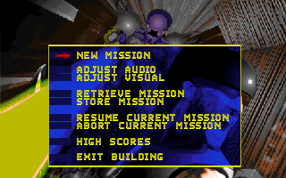

# Corridor 7: Alien Invasion — Static Recompilation


## What it is

A static recompilation of **Corridor 7: Alien Invasion** (Capstone Software /
IntraCorp, CD release, 1994) from its shipping DOS executable, `CORR7CD.EXE`,
to a native Windows program. Each of its 869 functions is lifted to C, compiled
with MSVC, and run against a small model of the 1994 PC (DOS, VGA, Sound
Blaster, AdLib, EMS, MSCDEX). The game's own code does everything else. No
DOSBox, no emulator.

Built on the [pcrecomp](https://github.com/sp00nznet/pcrecomp) toolchain and
following its shared house style (layout, CLI, `Setup.cmd` quick start,
launcher, headless mode). The runtime and lifter began as the
[Blake Stone recomp](https://github.com/sp00nznet/blakestone)'s.

## Status: **v0.1.0, early alpha. It boots, plays its intro, and you can play the first floor.**

| Stage | State |
|---|---|
| Version recompiled | `CORR7CD.EXE`, CD release (`CORR7.ID` dated 05/16/94) |
| Lift (`tools/lift.py c7`) | 869 functions, plus the compiled scalers the game writes at run time, interpreted |
| Startup checks, CD detection, EMS | ✅ |
| Capstone logo, title, intro movie | ✅ |
| Menus, rank select, loading a floor | ✅ |
| 3D view, walking, turning, firing, dying | ✅ |
| High scores and the attract loop | ✅ |
| AdLib music, Sound Blaster effects | runs; not yet listened to |
| CD audio tracks | ❌ not yet (requests are acknowledged and logged) |
| Saving and loading | untested |
| A full floor, a full playthrough | not yet |
| Linux, macOS | not yet (the SDL2 host from Blake Stone is here, untested) |
| Headless mode | `--headless`, `--record out.mp4`, `--keys` scripted input, `--shot-at` |
| Self-test (`tests/selftest.c`) | **passes: 14 checks** of the VGA (chain-4, Mode X, latches, CRTC start, DAC), x87 and Sound Blaster/AdLib models, no game data needed. netlab runs it as QA |
| Conformance harness (with the game) | not yet ([ROADMAP.md](ROADMAP.md)) |
| `Setup.cmd` quick start, launcher | written; not yet run end to end on a clean machine with the CD |

## Screenshots

Real output of the recompiled game (`--shot-at`):

| | |
|---|---|
|  |  |
| Title | The main menu |
|  |  |
| Firing on the first floor | A door |

## What is not in this repo

Nothing from the game: no executable, no data files, no disc image, and **no
generated source**. The lifted C is produced on your machine from your own copy
by `tools/lift.py`, into `work/c7/gen/`, which is gitignored. The tool ships;
its output never does.

## Getting Started

You need **your own Corridor 7 CD** (the USA release), an `.iso` of it, or a
folder copy of it. Nothing is downloaded for you.

### Quick start: Setup.cmd

1. Download this repository (the green **Code** button, then **Download ZIP**)
   and unzip it somewhere with 1 GB free.
2. Double-click **`Setup.cmd`**.

It checks for Python 3, CMake, the pcrecomp toolkit (and git to fetch it) and
the Visual Studio 2022 C++ compiler, and **asks** before installing any of
them, saying what and how big. It finds the CD in your drives (by its
`CORR7CD\CORR7CD.EXE`), or asks where it is (a drive, a folder, or an `.iso`,
which it mounts; `Setup.cmd -GameDir E:\` skips the question, `-Yes` answers yes
to every install). Then it copies the `CORR7CD` folder and `CORR7.ID` into
`original\c7`, lifts `CORR7CD.EXE`, builds `build\Release\corridor7.exe`, and
runs the self-test. A rerun skips the finished steps. If it stops, it says why
in one sentence, and the details are in `setup.log`.

It ends with a **`Corridor 7`** shortcut in the folder. Double-click it to play.

The installer (recomp-launcher with [`launcher/launcher.json`](launcher/launcher.json))
runs the same `Setup.cmd`; there is no release of it yet.

### Step by step

Prerequisites: Windows 10/11, **Python 3** (`py -3 --version`; the lifter needs
no packages), **CMake 3.20+**, **git**, **Visual Studio 2022** (or its Build
Tools) with *Desktop development with C++*, and the pcrecomp toolkit cloned
**beside** this repository as `pcrecomp` (or `PCRECOMP_HOME` set to one):

```
some-folder\
  pcrecomp\                     <- git clone https://github.com/sp00nznet/pcrecomp
  corridor7\                    <- this repository
```

1. Copy everything in the CD's `CORR7CD` folder, and `CORR7.ID` from the CD's
   root, into `original\c7\`.
2. Lift it:
   ```
   py -3 tools\lift.py c7
   ```
   It writes `work\c7\gen\`.
3. Build it:
   ```
   cmake -B build -G "Visual Studio 17 2022" -A Win32
   cmake --build build --config Release
   ```
4. Check the hardware models (no game data needed):
   ```
   build\Release\selftest.exe
   ```
   Expected: `selftest: all passed`.
5. Run it: `build\Release\corridor7.exe`.

The game finds "its CD" in drive D: and reads it from `original\c7`. Saved
games and `CONFIG` go to `saves\c7`.

The usual trip-ups: `python` opening the Microsoft Store (that is Windows' alias
placeholder; use `py -3`, or turn the alias off in *Settings > Apps > Advanced
app settings > App execution aliases*), and a freshly installed CMake or Python
not being on `PATH` until you open a new window.

## Usage

```
build\Release\corridor7.exe                                  # play, in a window
build\Release\corridor7.exe --fullscreen                     # Alt+Enter toggles
build\Release\corridor7.exe --headless --seconds 30 --keys "4000:ENTER,6000:ESC" --shot-at "20000:menu.bmp"
build\Release\corridor7.exe --headless --record out.mp4 --seconds 60
```

| Flag | |
|---|---|
| `--data DIR`, `--save DIR` | the game's files (default `original/c7`); CONFIG and saved games (default `saves/c7`) |
| `--headless` | no window, no audio device; time is deterministic |
| `--realtime` | headless, but on the wall clock |
| `--record OUT.mp4` | video and audio through ffmpeg |
| `--seconds N` | quit after N seconds of emulated time |
| `--keys LIST` | scripted input: `ms:KEY[+holdms],...` |
| `--mute` | silence |
| `--scale N`, `--display MODE` | window size in multiples of 320x240 (default 3); `sharp`, `pixel` or `crt` (F11 cycles) |
| `--trace` | log DOS calls to stderr |
| `--shot FILE.bmp`, `--shot-at LIST` | the last frame at exit; frames at emulated times, `ms:file.bmp,...` |
| `--wav OUT.wav` | write the audio (no ffmpeg needed) |

The full list is at the top of [`src/main.c`](src/main.c).

## Building from source

Steps 2 and 3 above. `PCRECOMP_HOME` (Python and CMake) points at a toolkit
checkout other than `..\pcrecomp`. On
[netlab](https://github.com/sp00nznet/recomp-netlab) the recipe is `corridor7`:
`netlab build corridor7`, and `netlab check corridor7` runs the self-test.
The pipeline and the machine model are [docs/architecture.md](docs/architecture.md);
what Corridor 7 needed on top of Blake Stone is [docs/lifting.md](docs/lifting.md).

## License

MIT, for the code in this repository ([LICENSE](LICENSE)). Third-party code and
credits are in [NOTICE](NOTICE): [ymfm](https://github.com/aaronsgiles/ymfm)
(BSD-3-Clause) is the OPL2, and the compiled-scaler interpreter follows the
[Wolfenstein 3-D recomp](https://github.com/sp00nznet/wolfdlss)'s. Corridor 7
itself is commercial software and is not included.
