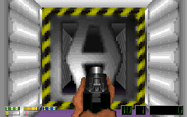

<div align="center">

# Corridor 7: Alien Invasion, recompiled

**Corridor 7: Alien Invasion** (CD, 1994), Capstone Software / IntraCorp,
taken apart from its shipping DOS executable and rebuilt as a native Windows program.
No DOSBox. No emulator. The 1994 machine code, translated once and compiled for a
machine that did not exist when it shipped.


</div>

## What it is

A static recompilation of `CORR7CD.EXE`, the CD version's executable. Each of
its 869 functions is lifted to C by [pcrecomp](https://github.com/sp00nznet/pcrecomp),
compiled with MSVC, and run against a small model of the 1994 PC (DOS, VGA,
Sound Blaster, AdLib, EMS, MSCDEX). The game's own code does everything else.

**Generated source is not distributed.** You supply your own copy of the game,
and the lifted C is generated on your machine. Nothing from the game is in this
repository.

## Status: early. It boots, plays its intro, and you can play the first floor.

| | |
|---|---|
| Version recompiled | `CORR7CD.EXE`, CD release (`CORR7.ID` dated 05/16/94) |
| Functions lifted | 869, plus the compiled scalers it writes at run time, interpreted |
| Startup checks, CD detection, EMS | ✅ |
| Capstone logo, title, intro movie | ✅ |
| Menus, rank select, loading a floor | ✅ |
| 3D view, walking, turning, firing, dying | ✅ |
| High scores and the attract loop | ✅ |
| AdLib music, Sound Blaster effects | runs; not yet listened to |
| CD audio tracks | not yet (requests are acknowledged and logged) |
| Saving and loading | untested |
| A full floor, a full playthrough | not yet |
| Linux, macOS | not yet (the SDL2 host from Blake Stone is here, untested) |
| Setup script, installer | not yet |

| | |
|---|---|
|  |  |
| Title | The main menu |
|  |  |
| Firing on the first floor | A door |

## Getting started

You need the Corridor 7 CD (the USA release), Python 3, CMake, and Visual
Studio 2022 with C++, plus a checkout of [pcrecomp](https://github.com/sp00nznet/pcrecomp)
next to this one (or `PCRECOMP_HOME` set to one).

1. Copy everything in the CD's `CORR7CD` folder, and `CORR7.ID` from the CD's
   root, into `original/c7/`.
2. Lift it: `py tools/lift.py c7`, which writes `work/c7/gen/`.
3. Build it:
   ```
   cmake -B build -A Win32
   cmake --build build --config Release
   ```
4. Run it: `build\Release\corridor7.exe`.

The game finds "its CD" in drive D: and reads it from `original/c7`.
Options (`--headless`, `--keys`, `--shot-at`, `--trace` and more) are listed
at the top of [`src/main.c`](src/main.c).

## How it works

[docs/architecture.md](docs/architecture.md) is the pipeline and the machine
model (from Blake Stone; it applies here unchanged).
[docs/lifting.md](docs/lifting.md) is what Corridor 7 needed on top of that.

## Credits

The runtime and lifter began as the [Blake Stone recomp](https://github.com/sp00nznet/blakestone)'s;
the compiled-scaler interpreter follows the [Wolfenstein 3-D recomp](https://github.com/sp00nznet/wolfdlss)'s.
[ymfm](https://github.com/aaronsgiles/ymfm) (BSD-3-Clause) is the OPL2.
See [NOTICE](NOTICE).

## License

MIT for the code in this repository; see [LICENSE](LICENSE). Corridor 7 itself
is commercial software and is not included.
