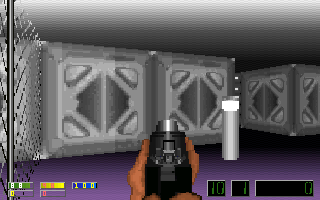
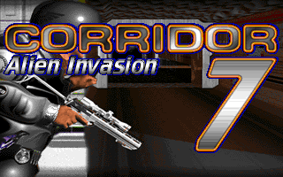
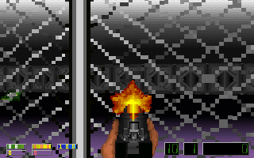

# Corridor 7: Alien Invasion — Static Recompilation

Static recompilation of **Corridor 7: Alien Invasion** (Capstone Software /
IntraCorp, CD release, 1994) from its shipping DOS executable, `CORR7CD.EXE`,
to a native Windows program. Each of its 869 functions is lifted to C,
compiled with MSVC, and run against a small model of the 1994 PC (DOS, VGA,
Sound Blaster, AdLib, EMS, MSCDEX); the game's own code does everything else.
No DOSBox, no emulator.

Built on the [pcrecomp](https://github.com/sp00nznet/pcrecomp) toolchain
(`main` branch). The runtime and lifter began as the
[Blake Stone recomp](https://github.com/sp00nznet/blakestone)'s.

## Getting Started

You need **your own Corridor 7 CD** (the USA release), an `.iso` of it, or a
folder copy of it. Nothing from the game is in this repository or downloaded
for you; everything is built on your machine from your copy.

### The setup scripts

1. Download this repository (the green **Code** button, then **Download ZIP**)
   and unzip it somewhere with 1 GB free.
2. Windows: double-click **`Setup.cmd`**. (`setup.sh` only says there is no
   Linux or macOS build yet.)
3. Play with the **`Corridor 7`** shortcut in that folder.

The script checks for Python 3, CMake, git and the Visual Studio 2022 C++
compiler and asks before installing any of them, fetches the pcrecomp toolkit
(`main`) beside this folder, finds the CD (or asks: a drive, a folder or an
`.iso`; `-GameDir E:\` skips the question, `-Yes` answers yes to every
install), copies the game into `original\c7`, lifts, builds and runs the
self-test. A rerun skips finished steps; if it stops, it says why, and the
details are in `setup.log`. Building by hand and the command line are in
**[docs/building.md](docs/building.md)**.

## Status

**v0.1.0, early alpha.** It boots, plays its intro, and you can play the first
floor.

| Stage | State |
|---|---|
| Version recompiled | `CORR7CD.EXE`, CD release (`CORR7.ID` dated 05/16/94) |
| Lift (`tools/lift.py c7`) | 869 functions, plus the compiled scalers the game writes at run time, interpreted |
| Startup checks, CD detection, EMS | ✅ |
| Capstone logo, title, intro movie | ✅ |
| Menus, rank select, loading a floor | ✅ |
| 3D view, walking, turning, firing, dying | ✅ |
| High scores and the attract loop | ✅ |
| AdLib music, Sound Blaster effects | runs; not yet listened to |
| CD audio tracks | ❌ not yet (requests are acknowledged and logged) |
| Saving and loading | untested |
| A full floor, a full playthrough | not yet |
| Linux, macOS | not yet |
| Headless mode | `--headless`, `--record out.mp4`, `--keys`, `--shot-at` |
| Self-test | passes: 14 checks, no game data needed; netlab runs it as QA |
| Conformance harness (with the game) | not yet |
| `Setup.cmd` | tested from a fresh clone against a folder copy of the CD |

[docs/lifting.md](docs/lifting.md) is the log of each wall and its fix, and
[ROADMAP.md](ROADMAP.md) what comes next.

## Screenshots

Real output of the recompiled game (`--shot-at`):

| | |
|---|---|
|  |  |
|  |  |

## Documentation

- [docs/building.md](docs/building.md): building by hand, the command line, netlab
- [docs/testing.md](docs/testing.md): the self-test and headless runs
- [docs/architecture.md](docs/architecture.md): the pipeline and the machine model
- [docs/lifting.md](docs/lifting.md): what Corridor 7 needed on top of Blake Stone
- [ROADMAP.md](ROADMAP.md), [CHANGELOG.md](CHANGELOG.md), [CONTRIBUTING.md](CONTRIBUTING.md)

## Contributors

See **[CONTRIBUTORS.md](CONTRIBUTORS.md)** for who did what.

## License

MIT for this repository's own code ([LICENSE](LICENSE)). Corridor 7 is ©
Capstone Software / IntraCorp; none of its files, and nothing generated from
them, is in this repository ([NOTICE.md](NOTICE.md), which also lists ymfm,
BSD-3-Clause).
